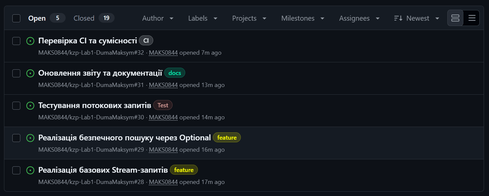
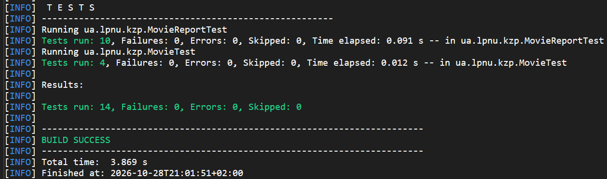
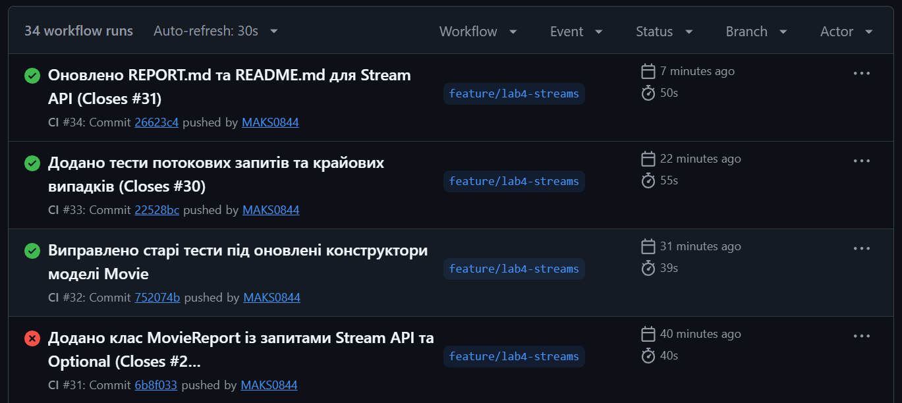

## Лабораторна робота №4: Потокова обробка даних у Java-проєкті

Виконані завдання:
1. Відновлення моделі (Issue #28): Повернено поля `director`, `duration` та `rating` до базового класу `Movie` та його підтипів для забезпечення роботи запитів Варіанта 8.
2. Реалізація Stream API (Issue #28): Ручні цикли замінено на декларативні запити у класі `MovieReport`: 
   - Відбір за рейтингом (`filter`).
   - Перетворення на список назв (`map`).
   - Групування за режисером із розрахунком середньої оцінки (`groupingBy`).
   - Зведена статистика тривалості (`summarizingInt`).
   - Top-N фільмів за допомогою складеного компаратора (`sorted`, `limit`).
3. Безпечний пошук (Issue #29): Реалізовано метод `findByTitle` з використанням `Optional` для безпечної обробки відсутнього результату без ризику `NullPointerException`.
4. Тестування (Issue #30): Написано 10 нових JUnit-тестів для перевірки дублікатів ключів, меж фільтра, складеного сортування, незмінності вхідної колекції та обробки порожніх списків.
5. Інфраструктура та Документація (Issue #31, #32): Оновлено звітність та забезпечено успішне проходження перевірок CI (SpotBugs, GitHub Actions).

Результати виконання:

Скриншот 1. Створені задачі (Issues) для потокових запитів:

Скриншот 2. Успішна компіляція та проходження 14 тестів (зокрема нових для Stream API):

Скриншот 3. Успішне проходження CI (GitHub Actions на всіх ОС):

## Висновки
Успішно переніс циклову обробку колекцій до декларативних конвеєрів Stream API. Відбір і перетворення відокремлено від агрегації, складений компаратор забезпечив надійне впорядкування, а `Optional` зробив пошук безпечним. Попередні тести й зовнішня поведінка продукту збережені. Створена потокова реалізація стане міцною основою для наступної роботи, у якій колекції будуть оброблятися складеними запитами, з додаванням експорту даних та обробки файлів.
