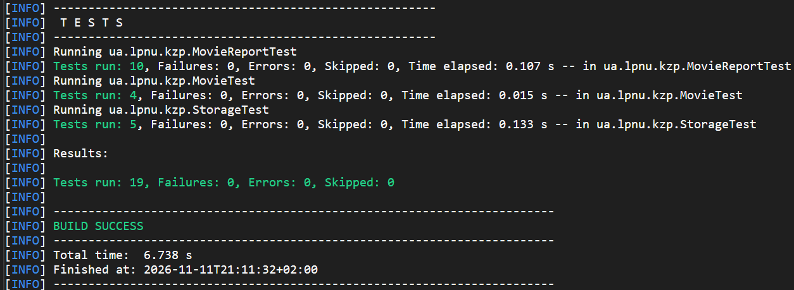
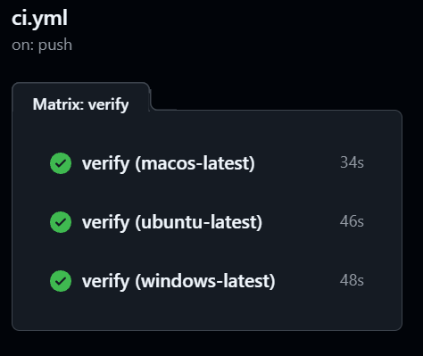
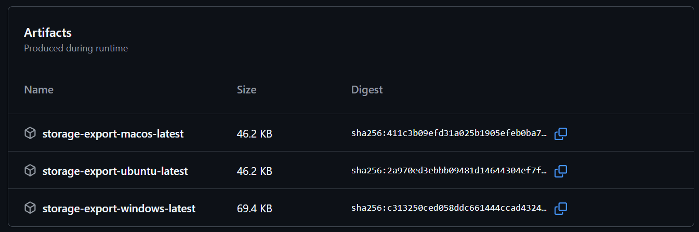

## Лабораторна робота №5: Параметризоване сховище, винятки й CSV-експорт у Java-проєкті

1. Тема, номер і варіант: Лабораторна робота №5. Варіант 8 (Каталог фільмів). ОС: Windows 11.
2. Мета роботи: Замінити пряме зберігання даних у списку на параметризоване сховище `Repository<T>`, додати власний виняток із ланцюгом причин, описати CSV-стовпці анотацією `@CsvColumn` та реалізувати експортер через рефлексію.
3. Стан до і після цієї роботи: До виконання роботи дані зберігалися в пам'яті (у звичайному `List`). Тепер додано `Repository<T>` для надійного зберігання та рефлексивні інструменти для експорту/імпорту (CSV). Попередні дані та тести не втрачено.

Виконані завдання (згідно з GitHub Issues):
1. Параметризоване сховище (Issue #34): Створено `Repository<T>` (без raw types). Метод `all()` повертає незмінний знімок списку для захисту даних.
2. Власний виняток (Issue #35): Створено `DataStorageException` із підтримкою `cause` (першопричини помилки).
3. Анотація та Модель (Issue #36): Оголошено `@CsvColumn(RUNTIME, FIELD)`. Створено плоский запис `MovieRecord` (title, director, year, durationMinutes, rating) з equals/hashCode для перевірки round-trip. 
4. Рефлексивний CsvExporter (Issue #37): Реалізовано експортер, що шукає анотовані поля, сортує їх за назвою та екранує значення (коми, лапки, перенесення рядків). Формат CSV: `Режисер,Тривалість,Оцінка,Назва,Рік`. Кодування UTF-8.
5. Імпорт і round-trip (Issue #38): Написано власну машину станів `CsvParser`. Тест доводить, що об'єкти до експорту та після імпорту ідентичні.
6. Інфраструктура (Issue #39, #40): Оновлено `.yml` для збірки на 3 ОС (Ubuntu, Windows, macOS) і створення JAR-артефакту.

Результати виконання:

Таблиця помилок:
| Тип помилки | Повідомлення / Умова | Cause (першопричина) | Перевірка (тест) |
| :--- | :--- | :--- | :--- |
| `IllegalArgumentException` | Валідація моделі (напр., рік > 2100) | Немає | У конструкторі `MovieRecord` |
| `DataStorageException` | Хибна кількість CSV-полів | Немає | `handlesEmptyInputAndInvalidCsv` |
| `DataStorageException` | Помилка створення/запису файлу | `IOException` | `wrapsFileErrorWithCause` |

Скріншот 1. Успішна збірка та проходження 19 тестів (разом зі старими):

Скріншот 2. Успішне проходження CI на всіх ОС (Windows, Ubuntu, macOS):

Скріншот 3. Згенеровані JAR-артефакти після збірки:

Примітка: Фактичний згенерований CSV-файл містить правильно екранований рядок (наприклад, `"Гаррі Поттер, частина 1"`).

## Висновки
У результаті виконання роботи проєкт розширено надійною системою збереження даних. Прямі списки замінено на типізоване сховище `Repository<T>`. Завдяки Reflection API та анотації `@CsvColumn` вдалося створити універсальний експортер, не прив'язаний до конкретної предметної області. Власна машина станів коректно парсить CSV-спецсимволи, а тести підтверджують безпомилковий round-trip об'єктів. Проєкт успішно автоматизовано для збірки JAR на різних ОС.
